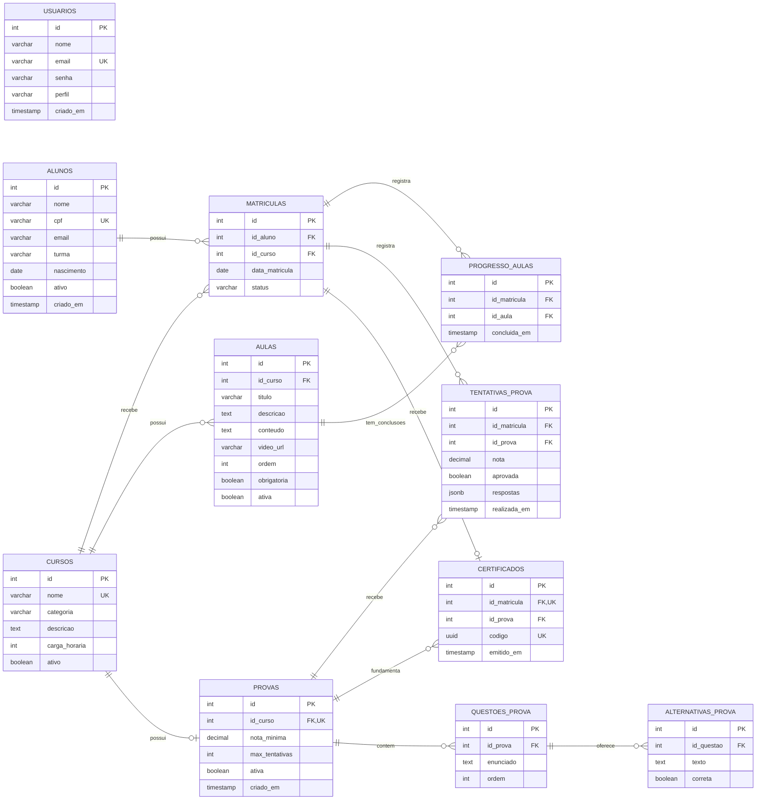
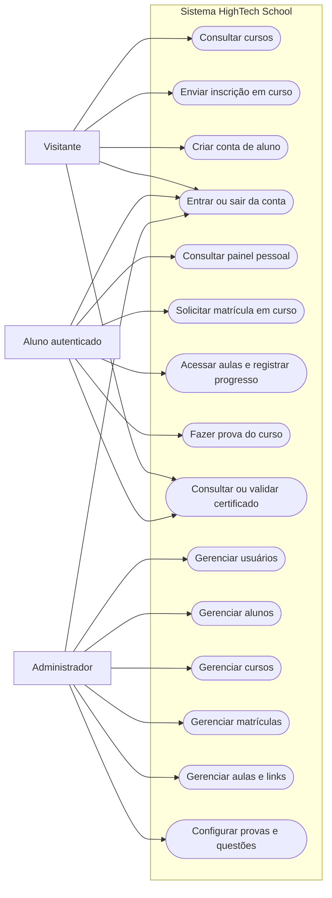
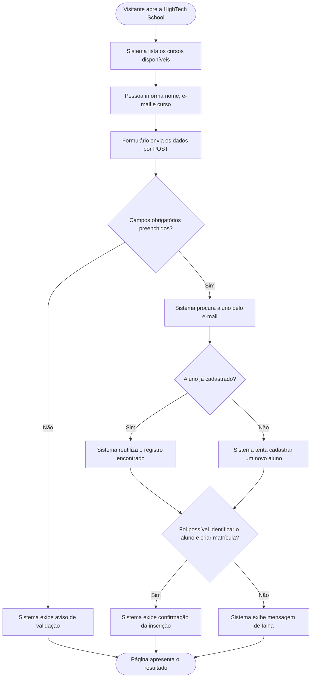

# HighTech — Sistema de serviços e educação em tecnologia

A **HighTech** é uma aplicação web acadêmica desenvolvida em PHP e PostgreSQL. O sistema combina um portal de serviços para empresas com a HighTech School, uma área de formação em tecnologia, e recursos para aproximar estudantes de oportunidades profissionais.

Por meio da aplicação, visitantes podem conhecer os serviços, consultar cursos e vagas, enviar solicitações corporativas e visualizar perfis profissionais públicos. Alunos podem criar uma conta, acompanhar matrículas, acessar as aulas dos cursos em que possuem matrícula ativa, registrar o progresso, fazer provas e receber certificados verificáveis após a aprovação. Administradores autenticados podem gerenciar alunos, cursos, matrículas, aulas e provas.

Para preparar a apresentação do projeto, consulte o [roteiro de apresentação](docs/roteiro_apresentacao.md) e o [questionário com respostas para estudo](docs/quest.md).

> Para conferir o comportamento atual, considere o código e `database/schema.sql` como referência. Requisitos marcados como parte do escopo anterior não estão implementados nesta versão.

---

## 📌 Sumário
- [Como executar o projeto localmente](#como-executar-o-projeto-localmente)
  - [Pré-requisitos](#pré-requisitos)
  - [Passo a passo de instalação](#passo-1-clonar-o-repositório)
  - [Como criar o primeiro administrador](#passo-6-criar-uma-conta-e-acessar)
- [Especificação de Requisitos de Software (SRS)](#especificação-de-requisitos-de-software)
  - [1. Introdução](#1-introdução)
  - [2. Descrição global](#2-descrição-global)
  - [3. Requisitos do sistema](#3-requisitos-do-sistema)
    - [Requisitos Funcionais](#31-requisitos-funcionais)
    - [Requisitos Não Funcionais](#32-requisitos-não-funcionais)
    - [Regras de Negócio](#33-regras-de-negócio)
- [4. Estruturação do banco de dados](#4-estruturação-do-banco-de-dados)
- [5. Diagramas](#5-diagramas)
  - [Diagrama de Entidade-Relacionamento (DER)](#51-diagrama-de-entidade-relacionamento-der)
  - [Diagrama de Casos de Uso](#52-diagrama-de-casos-de-uso)
  - [Diagrama de Classes Conceitual](#53-diagrama-de-classes-conceitual)
  - [Diagrama de Fluxo de Inscrição](#54-diagrama-de-fluxo-de-inscrição-em-curso)

---

## Como executar o projeto localmente

Para executar a aplicação localmente, é necessário ter PHP e PostgreSQL instalados.

### Pré-requisitos

- **PHP 7.4 ou superior**, com as extensões `PDO`, `pdo_pgsql` e `mbstring` habilitadas.
- **PostgreSQL** instalado e em execução.
- **Git** instalado para clonar o repositório.
- O cliente de linha de comando `psql`, incluído na instalação do PostgreSQL.

### Passo 1: Clonar o repositório

Abra um terminal e execute:

```bash
# Clona o repositório do projeto.
git clone https://github.com/joaorbm09/HighTech_school.git

# Entra na pasta criada pelo Git.
cd HighTech_school
```

### Passo 2: Criar o banco de dados

Crie um banco de dados vazio para o projeto. O exemplo abaixo usa o usuário PostgreSQL `postgres`:

```bash
psql -U postgres
```

No console `psql`, crie a role e defina uma senha própria:

```sql
CREATE USER admin_school WITH PASSWORD 'admin123';
CREATE DATABASE hightech_school OWNER admin_school;
\q
```

Se o banco `hightech_school` já existir, escolha outro nome ou remova somente o banco local de desenvolvimento antes de recriá-lo.

### Passo 3: Criar as tabelas e carregar os dados iniciais

Na raiz do repositório, execute o script SQL:

```bash
psql -U admin_school -d hightech_school -f database/schema.sql
```

O arquivo `database/schema.sql` cria as 11 tabelas do sistema (`usuarios`, `alunos`, `cursos`, `matriculas`, `aulas`, `progresso_aulas`, `provas`, `questoes_prova`, `alternativas_prova`, `tentativas_prova` e `certificados`) e insere dois cursos iniciais de demonstração.


### Passo 4: Configurar a conexão PHP

A aplicação lê as configurações em `database/connect.php`. Você pode definir variáveis de ambiente no seu sistema ou ajustar diretamente os valores padrão no arquivo:

- `DB_HOST`: Endereço do servidor PostgreSQL (padrão: `192.168.10.52`).
- `DB_PORT`: Porta do servidor (padrão: `5432`).
- `DB_NAME`: Nome da base de dados (padrão: `hightech_school`).
- `DB_USER`: Usuário do banco (padrão: `admin_school`).
- `DB_PASS`: Senha do usuário do banco (padrão: `admin123`).

Confirme que os módulos necessários estão habilitados:

```bash
php -m
```

Na lista apresentada, verifique a presença de `PDO`, `pdo_pgsql` e `mbstring`.

### Passo 5: Iniciar a aplicação

Na raiz do projeto, inicie o servidor embutido do PHP para testar no mesmo computador:

```bash
php -S localhost:8000
```

No navegador desse computador, abra:

```text
http://localhost:8000
```

O `index.php` redireciona para `aplicacao.php`, a página pública de cursos.

### Passo 6: Criar uma conta e acessar

1. Acesse `http://localhost:8000/login/cadastrar.php` e use a opção **Cadastrar-se** para criar uma conta de aluno. O formulário cria a conta de usuário e o registro acadêmico correspondente.
2. Por padrão, todas as contas criadas pelo formulário público recebem o perfil `aluno`.
3. **Para promover um usuário a Administrador**, conecte ao banco com o usuário PostgreSQL `admin_school` (não com `postgres`):

```bash
psql -h 127.0.0.1 -U admin_school -d hightech_school
```

No console `psql`, atualize o e-mail da conta que você acabou de cadastrar:

```sql
UPDATE usuarios SET perfil = 'admin' WHERE email = 'seu_email@exemplo.com';
\q
```

Confirme que apareceu `UPDATE 1`. Saia da conta no site e entre novamente para atualizar a sessão. Nenhum administrador é criado automaticamente. Com o perfil `admin`, novos menus de gestão serão liberados no cabeçalho: **Gestão Alunos**, **Gestão Cursos**, **Gestão de Aulas**, **Gestão de Provas** e **Matrículas**.

---

## Guia para Windows (PowerShell)

Se a aplicação já está instalada e funcionando, não recrie o banco e não importe o schema novamente. Use os passos de configuração e inicialização.

### 1. Abrir o projeto e verificar os programas

Abra a pasta do projeto no VS Code e escolha **Terminal → Novo Terminal** (PowerShell). Execute:

```powershell
Get-Location
Test-Path .\database\schema.sql
php -v
php -m
php --ini
$psqlExe = 'C:\Program Files\PostgreSQL\18\bin\psql.exe'
& $psqlExe --version
```

O Test-Path deve retornar True. Ajuste 18 no caminho se sua versão do PostgreSQL for outra. O operador & executa o programa cujo caminho contém espaços.

Em php -m, confira PDO, pdo_pgsql e mbstring. Se faltarem extensões, abra o php.ini indicado por php --ini e habilite extension=pdo_pgsql e extension=mbstring, retirando o ponto e vírgula inicial dessas linhas. Reinicie o servidor PHP depois de salvar. Se php não for reconhecido, configure o PATH ou use o caminho completo, por exemplo & 'C:\php\php.exe' -v.

### 2. Criar o banco somente na primeira instalação

```powershell
& $psqlExe -h 127.0.0.1 -U postgres
```

Digite a senha definida durante a instalação do PostgreSQL. Dentro do console psql, execute:

```sql
CREATE ROLE admin_school LOGIN;
\password admin_school
CREATE DATABASE hightech_school OWNER admin_school;
\q
```

O comando \password solicita uma senha própria para a aplicação. Guarde-a para o passo 4. Se a role ou banco já existir, confira a instalação existente; não apague seus dados para repetir o guia.

### 3. Importar as tabelas em um banco vazio

No PowerShell, na raiz do projeto:

```powershell
$env:PGCLIENTENCODING = 'UTF8'
& $psqlExe -h 127.0.0.1 -U admin_school -d hightech_school -v ON_ERROR_STOP=1 -1 -f '.\database\schema.sql'
```

Digite a senha de admin_school. O arquivo deve permanecer salvo em UTF-8. PGCLIENTENCODING evita que o psql interprete o arquivo como WIN1252; ON_ERROR_STOP interrompe no primeiro erro e -1 executa a importação em uma transação.

Não use Get-Content para encaminhar o SQL por um pipe. Não execute o schema sobre um banco já instalado.

Confira a conexão e os dois cursos iniciais:

```powershell
& $psqlExe -h 127.0.0.1 -U admin_school -d hightech_school -c 'SELECT nome FROM cursos ORDER BY id;'
```

### 4. Configurar e iniciar no mesmo terminal

```powershell
$env:DB_HOST = '127.0.0.1'
$env:DB_PORT = '5432'
$env:DB_NAME = 'hightech_school'
$env:DB_USER = 'admin_school'
$senhaBanco = Read-Host 'Senha de admin_school' -AsSecureString
$env:DB_PASS = [System.Net.NetworkCredential]::new('', $senhaBanco).Password
php -S localhost:8000
```

Abra http://localhost:8000. Mantenha o terminal aberto; Ctrl+C encerra o servidor. Essas variáveis valem para o terminal atual. Ao abrir outro terminal, repita este passo. O PHP precisa receber a senha como texto no ambiente, mas Read-Host evita que ela apareça na tela ou no histórico do comando.

### 5. Criar o primeiro administrador

Cadastre sua conta em http://localhost:8000/login/cadastrar.php. Em outro terminal PowerShell:

```powershell
& 'C:\Program Files\PostgreSQL\18\bin\psql.exe' -h 127.0.0.1 -U admin_school -d hightech_school
```

No console psql, substitua o e-mail pelo usado no cadastro:

```sql
UPDATE usuarios SET perfil = 'admin' WHERE LOWER(email) = LOWER('seu_email@exemplo.com');
\q
```

O resultado deve ser UPDATE 1. Saia da conta no site e entre novamente. O usuário admin_school conecta ao banco; ele não é uma conta do site.

### 6. Atualizar uma instalação que já tinha o administrador de demonstração

Primeiro atualize database/connect.php para a versão que não cria contas. Cadastre e promova sua própria conta pelo passo anterior e confirme que consegue acessar a gestão.

Depois, se admin@hightech.com for apenas a conta de demonstração, remova-a no console psql:

```sql
DELETE FROM usuarios WHERE email = 'admin@hightech.com' AND perfil = 'admin';
```

Não execute esse DELETE se esse for o e-mail da conta que você quer manter. A atualização dos arquivos não exclui contas existentes. Com o connect.php corrigido, a conta removida não é recriada ao navegar.

### Problemas comuns

| Mensagem | O que conferir |
| --- | --- |
| psql não reconhecido | Use o caminho completo com & e ajuste a versão instalada. |
| Connection refused | Verifique se o serviço PostgreSQL está iniciado no aplicativo Serviços do Windows e se a porta é 5432. |
| Password authentication failed | Confira o usuário e a senha; a senha do site é diferente da senha do banco. |
| Erro WIN1252 / UTF8 | Salve schema.sql em UTF-8 e use PGCLIENTENCODING antes da importação com -f. |
| Relation already exists | O banco já tem tabelas. Não repita o schema; confira a instalação existente. |
| Could not find driver | Habilite pdo_pgsql no php.ini usado pelo terminal. |
| Porta 8000 ocupada | Encerre o servidor anterior ou use php -S localhost:8001 e abra a porta 8001. |

---

## Guia de instalação em uma máquina Linux (MobaXterm / SSH)

Este roteiro instala a aplicação para demonstração ou avaliação em uma máquina Linux. Ele usa um usuário PostgreSQL exclusivo para a aplicação e o servidor embutido do PHP, apropriado para testes, não para publicar um serviço de produção na internet.

### 1. Conectar ao servidor

No MobaXterm, use o terminal para entrar no servidor:

```bash
ssh usuario@ip_do_servidor -p 2222
```

Exemplo:

```bash
ssh aluno@192.168.0.10
```

### 2. Verificar o ambiente

```bash
php -v
psql --version
```

Se o PHP ou PostgreSQL não estiverem instalados, execute:

```bash
sudo apt update
sudo apt install git php php-pgsql postgresql postgresql-contrib
```

### 3. Clonar o repositório

```bash
cd ~
git clone https://github.com/joaorbm09/HighTech_school.git hightech_school
cd ~/hightech_school
```

### 4. Criar o usuário PostgreSQL e o banco

Abra o console como administrador do PostgreSQL:

```bash
sudo -u postgres psql
```

Crie uma role de login exclusiva da aplicação, defina uma senha forte e torne-a proprietária do banco. A senha é solicitada de forma interativa e não fica exposta no comando:

```sql
CREATE ROLE admin_school LOGIN;
\password admin_school
CREATE DATABASE hightech_school OWNER admin_school;
\q
```

Não use `postgres` em `DB_USER`: essa conta serve para administração do servidor PostgreSQL. `admin_school` é a identidade de banco de dados da aplicação e é diferente tanto do usuário SSH/Linux quanto da conta administradora que fará login no site.

### 5. Importar o schema da aplicação

No diretório do projeto, importe o schema conectando como o proprietário do banco. O `-h 127.0.0.1` força a conexão TCP e permite autenticação pela senha criada no passo anterior:

```bash
cd ~/hightech_school
psql -h 127.0.0.1 -U admin_school -d hightech_school -f database/schema.sql
```

Digite a senha de `admin_school` quando solicitada. Esse comando cria as tabelas e também carrega os dados de demonstração. Execute-o somente em um banco novo.

### 6. Validar o usuário da aplicação

Teste a conexão do usuário empregado pela aplicação:

```bash
psql -h 127.0.0.1 -U admin_school -d hightech_school -c "SELECT 1;"
```

Se o comando retornar `1`, a conexão está correta. Se houver erro de autenticação, confira a senha e as regras de conexão do PostgreSQL; não substitua o usuário por `postgres`.

### 7. Configurar o ambiente PHP

Defina as variáveis antes de iniciar o PHP, substituindo os valores entre aspas pela configuração desta máquina. Use a mesma senha criada no passo 4. O exemplo vale para o servidor embutido iniciado no mesmo terminal:

```bash
export DB_HOST='localhost'
export DB_PORT='5432'
export DB_NAME='hightech_school'
export DB_USER='admin_school'
export DB_PASS='admin123'
```

As variáveis definidas com `export` ficam disponíveis apenas para esse terminal e processos iniciados por ele. Não compartilhe o terminal nem salve as senhas em arquivos públicos. A conexão não cria contas administrativas e não utiliza `APP_ADMIN_EMAIL` ou `APP_ADMIN_PASSWORD`. Em Apache/PHP-FPM, configure as variáveis de banco no ambiente do serviço; exportá-las no SSH não as disponibiliza automaticamente para esses serviços.

### 8. Iniciar a aplicação no servidor

Para demonstração ou avaliação, inicie o servidor embutido do PHP:

```bash
cd ~/hightech_school
```

Em seguida, acesse no navegador:

```text
http://<IP_DO_SERVIDOR>/Hightech_school
```

O servidor embutido é destinado a desenvolvimento e avaliação, não a produção. Não o exponha diretamente à internet. Para uma publicação real, use um servidor web/PHP-FPM configurado com HTTPS, permissões e variáveis de ambiente próprias; simplesmente copiar os arquivos para `/var/www/html` não configura esses componentes.

### 9. Criar o administrador da aplicação

O usuário `admin_school` acessa o banco; ele não é uma conta de login do site. Abra `http://<IP_DO_SERVIDOR>:8000/login/cadastrar.php` e cadastre uma conta própria. Depois, promova essa conta a administradora no banco:

```bash
psql -h localhost -U admin_school -d hightech_school
```

No console `psql`, substitua o e-mail pelo usado no cadastro:

```sql
UPDATE usuarios SET perfil = 'admin' WHERE email = 'seu-email@exemplo.com';
```

4. Entre novamente. O menu administrativo permite gerenciar: **Usuários**, **Alunos**, **Cursos**, **Matrículas**, **Aulas** e **Provas**.

## Limpeza do ambiente após os testes (opcional)

Depois de concluir a avaliação, você pode remover o ambiente de teste. Se quiser continuar usando a aplicação, mantenha a instalação. Os comandos abaixo apagam definitivamente os dados e os arquivos locais; salve antes o que desejar manter e confira os nomes e caminhos usados na sua instalação.

### 1. Encerrar a aplicação

No terminal em que o servidor PHP está em execução, pressione **Ctrl+C**. Feche também as conexões abertas com o banco, saindo do console `psql` com `\q`.

### 2. Excluir o banco e o usuário PostgreSQL

Execute esta etapa somente se `hightech_school` e `admin_school` foram criados exclusivamente para este teste. Não remova um usuário utilizado por outras aplicações.

No Windows (PowerShell), conecte como administrador ao banco de manutenção `postgres`, ajustando a versão instalada:

```powershell
& 'C:\Program Files\PostgreSQL\18\bin\psql.exe' -h 127.0.0.1 -U postgres -d postgres
```

No Linux, use:

```bash
sudo -u postgres psql -d postgres
```

Dentro do console `psql`, exclua primeiro o banco e depois o usuário:

```sql
DROP DATABASE hightech_school;
DROP ROLE admin_school;
\q
```

A exclusão do banco remove também todas as contas do site, matrículas e demais dados de teste. Se houver erro por conexões abertas, encerre-as antes de tentar novamente. Se a exclusão da role falhar por dependências em outros bancos, mantenha-a e confira onde ela é utilizada.

### 3. Excluir a pasta clonada

Apagar a pasta não remove o banco nem o usuário PostgreSQL. Execute esta etapa somente após salvar suas alterações e confirmar que está na raiz da cópia do projeto que deseja apagar.

No Windows (PowerShell), confira o caminho e saia da pasta antes de removê-la. O nome abaixo corresponde ao clone do guia local; ajuste-o se você usou outro nome:

```powershell
Get-Location
Set-Location ..
Resolve-Path -LiteralPath '.\HighTech_school'
Remove-Item -LiteralPath '.\HighTech_school' -Recurse -Confirm
```

No **Linux**, o guia usa a pasta `~/hightech_school`. Confira o caminho antes de confirmar a remoção:

```bash
cd ~
realpath /var/www/html/hightech_school
rm -rf /var/www/html/hightech_school
```

Os comandos de remoção solicitam confirmação. Confirme apenas se o caminho exibido corresponde à cópia de teste que deseja excluir. Mantenha o PHP e o PostgreSQL instalados se forem utilizados por outros projetos.

### Estrutura do projeto

```text
hightech_school/
├── aplicacao.php
├── index.php
├── readme.md
├── app/
│   ├── alunos.php
│   ├── aulas.php
│   ├── certificado.php
│   ├── cursos.php
│   ├── gerenciar_aulas.php
│   ├── gerenciar_provas.php
│   ├── matriculas.php
│   ├── meu_painel.php
│   ├── prova.php
│   └── usuarios.php
├── assets/
│   └── style.css
├── database/
│   ├── connect.php
│   └── schema.sql
├── docs/
│   ├── html-tags.md
│   └── roteiro_apresentacao.md
├── includes/
│   ├── auth.php
│   ├── footer.php
│   ├── functions.php
│   └── header.php
└── login/
    ├── cadastrar.php
    ├── login.php
    └── logout.php
```

---

## Especificação de requisitos de software

Especificação de Requisitos de Software (SRS), organizada como referência à estrutura da ISO/IEC/IEEE 29148:2018.

## 1. Introdução

#### 1.1 Escopo do sistema

Este documento descreve a aplicação **HighTech School**, um sistema de gestão escolar que administra cursos, alunos, matrículas, aulas, avaliações e certificados. A aplicação disponibiliza páginas públicas, autenticação de alunos e administradores, fluxo de aprendizagem completo e gestão de registros acadêmicos.

O sistema é implementado em PHP, utiliza PostgreSQL para persistência e acessa o banco por meio de PDO.

#### 1.2 Propósito

O propósito do sistema é centralizar operações acadêmicas, oferecendo um fluxo educacional completo — da matrícula à certificação. A aplicação também serve como projeto de aprendizagem sobre desenvolvimento web, sessões, operações CRUD, relacionamento entre tabelas, segurança e integração PHP/PostgreSQL.

---

## 2. Descrição global

#### 2.1 Prototipagem

[Prototipagem de baixo nivel da hightech_school](https://excalidraw.com/#json=gVz328tCF9BB35wzVHLIs,VWuX4ZX9WB5r-mbpKtikvA)

#### 2.2 Funções do sistema

O sistema oferece as seguintes funções principais:

1. Exibir cursos ativos e permitir inscrições públicas.
2. Cadastrar alunos como usuários e autenticar contas existentes.
3. Controlar o acesso às páginas administrativas por perfil.
4. Permitir que administradores gerenciem usuários (contas de acesso), alunos, cursos e matrículas.
5. Permitir que administradores cadastrem, editem, ordenem, publiquem e ocultem aulas com links externos.
6. Permitir que alunos com matrícula ativa acessem aulas e registrem conclusão.
7. Exibir no painel o progresso real das aulas de cada curso.
8. Permitir que administradores configurem provas e cadastrem questões de múltipla escolha.
9. Liberar a prova após conclusão das aulas obrigatórias e registrar cada tentativa e nota.
10. Emitir certificado automaticamente após aprovação e permitir consulta pública.
11. Disponibilizar ao aluno um painel com seus cursos, progresso e matrícula rápida.
12. Encerrar a sessão do usuário e redirecioná-lo ao catálogo de cursos.

#### 2.2 Classes de usuários

| Usuário | Descrição e permissões |
| --- | --- |
| **Visitante** | Pode consultar cursos e enviar inscrição. |
| **Aluno** | Pode autenticar, acessar o painel, estudar aulas, fazer provas, consultar certificados e solicitar matrículas. |
| **Administrador** | Pode acessar as telas de gestão de usuários, alunos, cursos, matrículas, aulas e provas, além das funções disponíveis ao aluno. |

O cadastro público cria contas com o perfil `aluno`. O perfil `admin` precisa ser atribuído por um processo administrativo; o esquema SQL não cria uma conta administrativa.

---

## 3. Requisitos do sistema

### 3.1 Requisitos funcionais

#### Módulo de acesso e autenticação

| ID | Título | Descrição | Prioridade |
| --- | --- | --- | --- |
| **RF01** | Cadastro de aluno | O sistema deve permitir que um visitante crie uma conta de aluno informando nome, e-mail e senha. | Alta |
| **RF02** | Validação de cadastro | O sistema deve verificar o preenchimento dos campos obrigatórios, a confirmação da senha, o tamanho mínimo de seis caracteres e a existência prévia do e-mail. | Alta |
| **RF03** | Autenticação | O sistema deve permitir que o usuário entre com e-mail e senha válidos. | Alta |
| **RF04** | Controle de acesso | O sistema deve exigir autenticação para o painel do aluno e autenticação com perfil `admin` para as páginas administrativas. | Alta |
| **RF05** | Encerramento da sessão | O sistema deve permitir que o usuário encerre a sessão e seja redirecionado ao portal. | Média |

#### Módulo institucional e de solicitações empresariais

| ID | Título | Descrição | Prioridade |
| --- | --- | --- | --- |
| **RF06** | Apresentação dos serviços | O sistema deve apresentar informações sobre os serviços corporativos e a HighTech School. | Média |
| **RF07** | Solicitação de diagnóstico | O sistema deve permitir que uma empresa envie seus dados de contato, serviço de interesse e uma mensagem opcional. | Alta |
| **RF08** | Retorno do envio | O sistema deve informar se a solicitação corporativa foi registrada ou se ocorreu uma falha. | Média |

#### Módulo de cursos, alunos e matrículas

| ID | Título | Descrição | Prioridade |
| --- | --- | --- | --- |
| **RF09** | Consulta de cursos | O sistema deve exibir os cursos cadastrados com categoria, descrição e carga horária. | Alta |
| **RF10** | Inscrição pública | O sistema deve permitir que uma pessoa informe seus dados e selecione um curso para criar ou reutilizar um registro de aluno e solicitar matrícula. | Alta |
| **RF11** | Gestão de alunos | O sistema deve permitir que administradores consultem, cadastrem, editem e excluam alunos. | Alta |
| **RF12** | Gestão de cursos | O sistema deve permitir que administradores consultem, cadastrem, editem e excluam cursos. | Alta |
| **RF13** | Gestão de matrículas | O sistema deve permitir que administradores criem matrículas, consultem a listagem combinada de alunos e cursos e cancelem matrículas. | Alta |
| **RF14** | Painel individual do aluno | O sistema deve permitir que um aluno autenticado consulte seus cursos e a carga horária total exibida no painel. | Média |
| **RF15** | Perfil profissional | O sistema deve permitir que o aluno crie ou atualize seu título profissional, biografia, links, habilidades e disponibilidade pública. | Média |
| **RF16** | Matrícula rápida | O painel do aluno deve permitir o envio de solicitação de matrícula em outro curso. | Média |

#### Módulo de talentos e oportunidades

| ID | Título | Descrição | Prioridade |
| --- | --- | --- | --- |
| **RF17** | Vitrine de talentos | O sistema deve exibir perfis marcados como disponíveis de alunos ativos. | Média |
| **RF18** | Busca de talentos | O sistema deve permitir filtrar a vitrine por nome, título profissional ou habilidades. | Média |
| **RF19** | Mural de vagas | O sistema deve listar vagas ativas com informações de empresa, modalidade, contrato e candidatura. | Média |
| **RF20** | Filtro de vagas | O sistema deve permitir filtrar as vagas por modalidade de trabalho. | Média |

#### Módulo de aulas, avaliações e certificação

| ID | Título | Descrição | Prioridade |
| --- | --- | --- | --- |
| **RF13** | Acesso às aulas | O sistema deve liberar aulas somente para aluno com matrícula ativa. | Alta |
| **RF14** | Registro de progresso | O sistema deve permitir que o aluno marque aulas como concluídas. | Alta |
| **RF15** | Gestão de aulas | Administradores devem poder cadastrar, editar, ordenar, publicar e ocultar aulas. | Alta |
| **RF16** | Gestão de provas | Administradores devem poder configurar nota mínima, tentativas e questões. | Alta |
| **RF17** | Realização de prova | A prova deve ser liberada após conclusão das aulas obrigatórias, corrigida no servidor. | Alta |
| **RF18** | Certificado verificável | Emissão de código UUID após aprovação, com validação pública. | Alta |

### 3.2 Requisitos não funcionais

| ID | Título | Descrição | Prioridade |
| --- | --- | --- | --- |
| **RNF01** | Tecnologias | PHP 7.4+ com PDO, `pdo_pgsql` e `mbstring`; PostgreSQL. | Alta |
| **RNF02** | Separação de responsabilidades | Conexão, autenticação, funções, páginas e estilos em arquivos próprios. | Média |
| **RNF03** | Compatibilidade web | Acessível por navegadores modernos sem cliente específico. | Média |
| **RNF04** | Acesso ao banco | Valores do usuário enviados por parâmetros PDO (prepared statements). | Alta |
| **RNF05** | Proteção de senhas | Senhas armazenadas como hash bcrypt. | Alta |
| **RNF06** | Proteção de páginas | Sessão e perfil validados antes de exibir dados. | Alta |
| **RNF07** | Saída HTML | Dados dinâmicos escapados com `htmlspecialchars`. | Alta |
| **RNF08** | Integridade referencial | Chaves estrangeiras com `ON DELETE CASCADE` no banco. | Alta |
| **RNF09** | Interface consistente | Cabeçalho, navegação e rodapé reutilizados via includes. | Média |
| **RNF10** | Layout adaptável | Grids e formulários responsivos via CSS. | Média |
| **RNF11** | Feedback de operações | Mensagens de sucesso, erro e validação nos formulários. | Média |

### 3.3 Regras de negócio

| ID | Título | Regra / condição |
| --- | --- | --- |
| **RN01** | Perfil inicial de cadastro | Contas criadas pelo formulário público recebem o perfil `aluno`. |
| **RN02** | Acesso administrativo | Somente uma sessão autenticada cujo perfil seja `admin` pode acessar as páginas administrativas de alunos, cursos, matrículas, aulas e provas. |
| **RN03** | Acesso ao painel do aluno | O painel individual exige uma sessão autenticada. |
| **RN04** | Senha de conta | O cadastro rejeita senhas com menos de seis caracteres e exige que a confirmação corresponda à senha. |

#### Módulo acadêmico

| ID | Título | Regra / condição |
| --- | --- | --- |
| **RN05** | Campos obrigatórios de aluno | Nome e e-mail são obrigatórios nas operações administrativas de cadastro e atualização de aluno. |
| **RN06** | Campos obrigatórios de curso | Nome, categoria e carga horária maior que zero são necessários para salvar um curso pela tela administrativa. |
| **RN07** | Relação de matrícula | Cada matrícula referencia um aluno e um curso existentes. |
| **RN08** | Exclusão em cascata | A exclusão de aluno ou curso remove do banco os registros de matrícula associados; a exclusão de aluno também remove seu perfil de talento. |
| **RN09** | Perfil de talento por aluno | Cada aluno pode ter no máximo um perfil de talento, conforme a restrição única de `perfil_talento.id_aluno`. |
| **RN10** | Visibilidade de talentos | A vitrine pública inclui apenas perfis com `disponivel_mercado = true` pertencentes a alunos ativos. |

#### Módulo corporativo e de oportunidades

| ID | Título | Regra / condição |
| --- | --- | --- |
| **RN11** | Solicitação empresarial | Empresa, responsável, e-mail e serviço de interesse são obrigatórios no formulário do portal; a nova solicitação recebe status `Pendente`. |
| **RN12** | Exibição de vagas | A listagem pública apresenta somente vagas ativas por padrão. |
| **RN13** | Candidatura | O contato de candidatura pode ser exibido como endereço de e-mail ou como link fornecido no cadastro da vaga. |
| **RN14** | CPF opcional e único quando informado | O CPF pode ficar vazio; quando informado, o índice parcial impede repetições entre valores não nulos. |

#### Módulo de aulas, avaliações e dados do aluno

| ID | Título | Regra / condição |
| --- | --- | --- |
| **RN15** | Liberação da prova | A prova ativa só pode ser realizada com matrícula ativa e após concluir todas as aulas obrigatórias que estejam publicadas. |
| **RN16** | Aprovação | A nota da prova é calculada no servidor e deve atingir ou superar a nota mínima configurada para o curso. |
| **RN17** | Limite de tentativas | A prova impede novas tentativas depois de atingir o limite configurado, entre 1 e 20 tentativas. |
| **RN18** | Emissão única | Cada matrícula aprovada recebe um único certificado com código aleatório para validação pública. |
| **RN19** | Faixa etária do aluno | A data de nascimento, quando informada, deve corresponder a uma idade entre 14 e 100 anos, rejeitando datas futuras ou incompatíveis com o público da escola. |

---

## 4. Estruturação do banco de dados

O banco PostgreSQL utiliza onze tabelas. Os campos e as regras abaixo correspondem ao arquivo `database/schema.sql`.

#### Entidade: `usuarios` (contas de acesso)

| Campo | Tipo | Restrições | Descrição |
| --- | --- | --- | --- |
| `id` | SERIAL | PRIMARY KEY | Identificador da conta. |
| `nome` | VARCHAR(100) | NOT NULL | Nome exibido nas páginas. |
| `email` | VARCHAR(100) | UNIQUE, NOT NULL | E-mail usado no login. |
| `senha` | VARCHAR(255) | NOT NULL | Hash de senha. |
| `perfil` | VARCHAR(20) | DEFAULT 'aluno', CHECK | Perfil: `aluno` ou `admin`. |
| `criado_em` | TIMESTAMP | DEFAULT CURRENT_TIMESTAMP | Data de criação. |

#### Entidade: `alunos` (cadastro acadêmico)

| Campo | Tipo | Restrições | Descrição |
| --- | --- | --- | --- |
| `id` | SERIAL | PRIMARY KEY | Identificador do aluno. |
| `nome` | VARCHAR(100) | NOT NULL | Nome completo. |
| `cpf` | VARCHAR(14) | Opcional; índice único parcial | Documento opcional; valores não nulos não podem se repetir. |
| `email` | VARCHAR(100) | NOT NULL | E-mail de contato e associação com a conta. |
| `turma` | VARCHAR(20) | Opcional | Turma ou grupo acadêmico. |
| `nascimento` | DATE | Opcional | Data de nascimento. |
| `ativo` | BOOLEAN | DEFAULT true | Status do aluno. |
| `criado_em` | TIMESTAMP | DEFAULT CURRENT_TIMESTAMP | Data de criação. |

#### Entidade: `cursos`

| Campo | Tipo | Restrições | Descrição |
| --- | --- | --- | --- |
| `id` | SERIAL | PRIMARY KEY | Identificador. |
| `nome` | VARCHAR(100) | NOT NULL, UNIQUE | Nome do curso. |
| `categoria` | VARCHAR(50) | NOT NULL | Área do curso. |
| `descricao` | TEXT | Opcional | Descrição. |
| `carga_horaria` | INT | NOT NULL, CHECK > 0 | Duração em horas. |
| `ativo` | BOOLEAN | DEFAULT true | Status. |

#### Entidade: `matriculas`

| Campo | Tipo | Restrições | Descrição |
| --- | --- | --- | --- |
| `id` | SERIAL | PRIMARY KEY | Identificador. |
| `id_aluno` | INT | FK → alunos, CASCADE | Aluno. |
| `id_curso` | INT | FK → cursos, CASCADE | Curso. |
| `data_matricula` | DATE | DEFAULT CURRENT_DATE | Data. |
| `status` | VARCHAR(20) | DEFAULT 'Ativa' | Situação. |

#### Entidades de aulas e progresso

| Tabela | Campo | Tipo | Restrições | Descrição |
| --- | --- | --- | --- | --- |
| `aulas` | `id` | SERIAL | PK | Identificador. |
| `aulas` | `id_curso` | INT | FK → cursos, CASCADE | Curso. |
| `aulas` | `titulo` | VARCHAR(150) | NOT NULL | Título. |
| `aulas` | `descricao`, `conteudo` | TEXT | Opcional | Material. |
| `aulas` | `video_url` | VARCHAR(500) | Opcional | Link do material. |
| `aulas` | `ordem` | INT | NOT NULL, UNIQUE por curso | Posição. |
| `aulas` | `obrigatoria`, `ativa` | BOOLEAN | DEFAULT true | Flags. |
| `progresso_aulas` | `id_matricula`, `id_aula` | INT | FK, UNIQUE em conjunto | Matrícula + aula. |
| `progresso_aulas` | `concluida_em` | TIMESTAMP | DEFAULT CURRENT_TIMESTAMP | Quando concluiu. |

#### Entidades de provas, questões e certificados

| Tabela | Campos principais | Regras |
| --- | --- | --- |
| `provas` | `id`, `id_curso`, `nota_minima`, `max_tentativas`, `ativa` | Uma prova por curso; nota de 1 a 100; 1 a 20 tentativas. |
| `questoes_prova` | `id`, `id_prova`, `enunciado`, `ordem` | Ordem única dentro da prova. |
| `alternativas_prova` | `id`, `id_questao`, `texto`, `correta` | Alternativas com uma resposta correta. |
| `tentativas_prova` | `id`, `id_matricula`, `id_prova`, `nota`, `aprovada`, `respostas`, `realizada_em` | Resultado e respostas em JSONB. |
| `certificados` | `id`, `id_matricula`, `id_prova`, `codigo`, `emitido_em` | Um por matrícula; código UUID único. |

---

## 5. Diagramas

### 5.1 Diagrama de entidade-relacionamento (DER)

O diagrama representa as 11 tabelas do banco em uma única visão, com leitura da esquerda para a direita. As relações mostram tanto a estrutura dos cursos quanto os registros individuais de aprendizagem.



**Como ler as ligações:** `||` significa exatamente um, `o|` significa zero ou um e `o{` significa zero ou muitos. Por exemplo, um aluno pode ter várias matrículas, mas cada matrícula pertence a exatamente um aluno. `PK`, `FK` e `UK` indicam, respectivamente, chave primária, chave estrangeira e chave única.

#### Por que a prova está ligada ao curso?

A dúvida faz sentido ao olhar para a experiência de uso: quem entra no sistema, responde às questões e recebe uma nota é o aluno. No banco, essa experiência é representada por duas entidades diferentes: **a avaliação preparada para o curso** e **cada tentativa realizada por um aluno**.

| Entidade | O que representa | Vínculo principal |
| --- | --- | --- |
| `provas` | Configuração da avaliação: nota mínima, limite de tentativas e publicação. As questões estão em `questoes_prova`. | `id_curso` identifica o curso avaliado. |
| `matriculas` | A participação de um aluno em um curso específico. | `id_aluno` e `id_curso` identificam essa participação. |
| `tentativas_prova` | Uma realização da avaliação, com respostas, nota, aprovação e data. | `id_matricula` identifica a participação do aluno; `id_prova` identifica a avaliação respondida. |

Por exemplo, Ana e Bruno estão matriculados em **Banco de Dados com PostgreSQL**. O administrador prepara uma prova para esse curso, com as mesmas questões e critérios para ambos. Ana faz a prova e tira 80; Bruno faz a mesma prova e tira 60. Existe **um registro em `provas`**, mas **duas tentativas**, cada uma ligada à matrícula correspondente. Se Bruno puder tentar novamente, será criado outro registro em `tentativas_prova`, preservando sua primeira nota.

O caminho até o resultado individual é, portanto, `alunos → matriculas → tentativas_prova`. Cada tentativa também aponta para `provas`, que informa qual avaliação foi respondida. Usar a matrícula permite identificar simultaneamente **quem é o aluno e em qual curso ele está inscrito**, além de verificar a situação dessa inscrição. A conta em `usuarios` serve para autenticação; atualmente, a aplicação encontra o registro em `alunos` pelo e-mail, sem uma chave estrangeira entre essas duas tabelas.

**Nesse funcionamento, a ligação direta entre `cursos` e `provas` faz sentido:** ela define a avaliação do curso. Substituí-la por uma ligação direta com o usuário confundiria a configuração compartilhada com a realização individual, que já é registrada em `tentativas_prova`. A restrição `UNIQUE` em `provas.id_curso` permite no máximo uma prova por curso; um curso ainda pode não ter prova cadastrada.

Uma mudança nesse relacionamento seria necessária se a regra do projeto fosse outra: por exemplo, avaliações independentes dos cursos ou provas personalizadas para cada aluno. Para o fluxo implementado hoje, a separação entre prova e tentativa atende ao uso individual. Ao enviar uma tentativa, a aplicação também verifica se a prova pertence ao mesmo curso da matrícula; as chaves estrangeiras, sozinhas, não garantem essa correspondência.

### 5.2 Diagrama de casos de uso

O diagrama resume as ações disponíveis para visitantes, alunos e administradores. A autorização das telas administrativas é verificada no servidor.



### 5.3 Diagrama de classes conceitual

O diagrama apresenta uma visão conceitual das entidades persistidas e das associações existentes. Ele não representa classes PHP: o projeto implementa as operações como funções e páginas.

### 5.3 Diagrama de fluxo de inscrição em curso

O fluxo abaixo representa o envio público de inscrição tratado por `aplicacao.php`.



### 5.4 Diagrama de fluxo de aprendizagem


