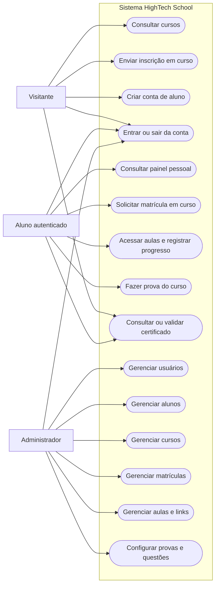
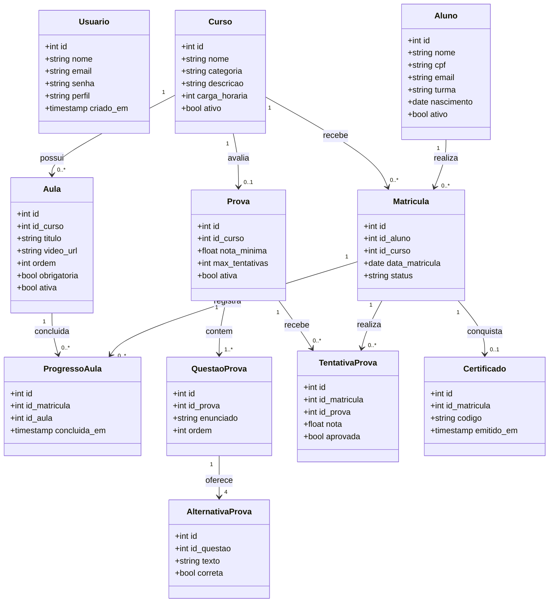
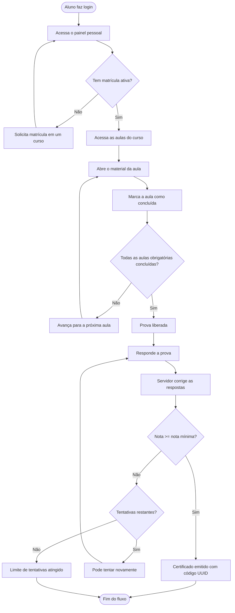

# HighTech School — Sistema de gestão escolar

A **HighTech School** é uma aplicação web acadêmica desenvolvida em PHP e PostgreSQL, focada exclusivamente na gestão educacional. O sistema permite que visitantes conheçam os cursos, que alunos criem contas, estudem aulas, acompanhem o progresso, realizem provas e obtenham certificados verificáveis. Administradores autenticados gerenciam usuários, alunos, cursos, matrículas, aulas e provas.

Esta versão é derivada do projeto [HighTech](https://github.com/joaorbm09/HighTech), sem os módulos de portal empresarial, vagas e talentos — concentrando-se nas funcionalidades essenciais de aprendizagem e gestão escolar.

Para entender todas as tecnologias usadas no projeto (HTML, CSS, PHP, SQL) e o motivo de cada escolha, consulte a [documentação de tecnologias](docs/html-tags.md).

Para o roteiro de apresentação do projeto, consulte o [roteiro de apresentação](docs/roteiro_apresentacao.md).

> Este documento descreve o comportamento e a estrutura presentes no projeto. Recursos mencionados como possibilidades futuras não devem ser considerados implementados.

---

## 📌 Sumário
- [Como executar o projeto localmente](#como-executar-o-projeto-localmente)
  - [Pré-requisitos](#pré-requisitos)
  - [Passo a passo de instalação](#passo-1-clonar-o-repositório)
  - [Como criar o primeiro administrador](#primeiro-administrador)
- [Especificação de Requisitos de Software (SRS)](#especificação-de-requisitos-de-software)
  - [1. Introdução](#1-introdução)
  - [2. Descrição global](#2-descrição-global)
  - [3. Requisitos do sistema](#3-requisitos-do-sistema)
    - [Requisitos Funcionais](#31-requisitos-funcionais)
    - [Requisitos Não Funcionais](#32-requisitos-não-funcionais)
    - [Regras de Negócio](#33-regras-de-negócio)
- [4. Estruturação do banco de dados](#4-estruturação-do-banco-de-dados)
- [5. Diagramas](#5-diagramas)
  - [Diagrama de Entidade-Relacionamento (DER)](#51-diagrama-de-entidade-relacionamento-der)
  - [Diagrama de Casos de Uso](#52-diagrama-de-casos-de-uso)
  - [Diagrama de Classes Conceitual](#53-diagrama-de-classes-conceitual)
  - [Diagrama de Fluxo de Inscrição](#54-diagrama-de-fluxo-de-inscrição-em-curso)

---

## Como executar o projeto localmente

Para executar a aplicação localmente, é necessário ter PHP e PostgreSQL instalados.

### Pré-requisitos

- **PHP 7.4 ou superior**, com as extensões `PDO`, `pdo_pgsql` e `mbstring` habilitadas.
- **PostgreSQL** instalado e em execução.
- **Git** instalado para clonar o repositório.
- O cliente de linha de comando `psql`, incluído na instalação do PostgreSQL.

### Passo 1: Clonar o repositório

Abra um terminal e execute:

```bash
# Clona o repositório do projeto.
git clone https://github.com/joaorbm09/HighTech_school.git

# Entra na pasta criada pelo Git.
cd HighTech_school
```

### Passo 2: Criar o banco de dados

Crie um banco de dados vazio para o projeto. O exemplo abaixo usa o usuário PostgreSQL `postgres`:

```bash
psql -U postgres -c "CREATE DATABASE hightech_school;"
```

Se o banco `hightech_school` já existir, escolha outro nome ou remova somente o banco local de desenvolvimento antes de recriá-lo.

### Passo 3: Criar as tabelas e carregar os dados iniciais

Na raiz do repositório, execute o script SQL:

```bash
psql -U postgres -d hightech_school -f database/schema.sql
```

O arquivo `database/schema.sql` cria as 9 tabelas do sistema (usuarios, alunos, cursos, matriculas, aulas, progresso_aulas, provas, questoes_prova, alternativas_prova, tentativas_prova, certificados) e insere dois cursos iniciais de demonstração.

#### Aplicar pelo pgAdmin

1. Abra o **pgAdmin** e conecte-se ao servidor PostgreSQL.
2. No navegador à esquerda, expanda **Servers → seu servidor → Databases** e clique uma vez no banco `hightech_school`.
3. Clique com o botão direito nesse banco e escolha **Query Tool**.
4. No Query Tool, use **Open File** e selecione o arquivo `database/schema.sql` dentro da pasta do projeto.
5. Pressione **F5** (ou clique no botão **Execute**).
6. O painel de mensagens deve indicar que os comandos `CREATE TABLE` foram executados.

### Passo 4: Configurar a conexão PHP

A aplicação lê as configurações em `database/connect.php`. Você pode definir variáveis de ambiente no seu sistema ou ajustar diretamente os valores padrão no arquivo:

- `DB_HOST`: Endereço do servidor PostgreSQL (padrão: `127.0.0.1`).
- `DB_PORT`: Porta do servidor (padrão: `5432`).
- `DB_NAME`: Nome da base de dados (padrão: `hightech_school`).
- `DB_USER`: Usuário do banco (padrão: `postgres`).
- `DB_PASS`: Senha do usuário do banco (padrão: vazia).

Confirme que os módulos necessários estão habilitados:

```bash
php -m
```

Na lista apresentada, verifique a presença de `PDO`, `pdo_pgsql` e `mbstring`.

### Passo 5: Iniciar a aplicação

Na raiz do projeto, inicie o servidor embutido do PHP:

```bash
php -S localhost:8000
```

Abra o endereço abaixo no navegador:

```text
http://localhost:8000
```

O `index.php` redireciona para `aplicacao.php`, a página pública de cursos.

### Primeiro administrador

1. Acesse `http://localhost:8000/login/cadastrar.php` e crie uma conta.
2. Por padrão, todas as contas criadas recebem o perfil `aluno`.
3. **Para promover um usuário a administrador**, execute no pgAdmin ou psql:

```sql
UPDATE usuarios SET perfil = 'admin' WHERE email = 'seu-email@exemplo.com';
```

4. Entre novamente. O menu administrativo permite gerenciar: **Usuários**, **Alunos**, **Cursos**, **Matrículas**, **Aulas** e **Provas**.

### Pastas principais

| Pasta | Conteúdo |
| --- | --- |
| `app/` | Telas de gestão administrativa e de aprendizagem do aluno. |
| `assets/` | Folha de estilos CSS compartilhada. |
| `database/` | Conexão com o banco (`connect.php`) e esquema SQL (`schema.sql`). |
| `docs/` | Documentação de tecnologias e roteiro de apresentação. |
| `includes/` | Autenticação (`auth.php`), funções (`functions.php`), cabeçalho e rodapé. |
| `login/` | Cadastro, login e logout. |

---

## Especificação de requisitos de software

Especificação de Requisitos de Software (SRS), organizada como referência à estrutura da ISO/IEC/IEEE 29148:2018.

## 1. Introdução

#### 1.1 Escopo do sistema

Este documento descreve a aplicação **HighTech School**, um sistema de gestão escolar que administra cursos, alunos, matrículas, aulas, avaliações e certificados. A aplicação disponibiliza páginas públicas, autenticação de alunos e administradores, fluxo de aprendizagem completo e gestão de registros acadêmicos.

O sistema é implementado em PHP, utiliza PostgreSQL para persistência e acessa o banco por meio de PDO.

#### 1.2 Propósito

O propósito do sistema é centralizar operações acadêmicas, oferecendo um fluxo educacional completo — da matrícula à certificação. A aplicação também serve como projeto de aprendizagem sobre desenvolvimento web, sessões, operações CRUD, relacionamento entre tabelas, segurança e integração PHP/PostgreSQL.

---

## 2. Descrição global

#### 2.1 Funções do sistema

O sistema oferece as seguintes funções principais:

1. Exibir cursos ativos e permitir inscrições públicas.
2. Cadastrar alunos como usuários e autenticar contas existentes.
3. Controlar o acesso às páginas administrativas por perfil.
4. Permitir que administradores gerenciem usuários (contas de acesso), alunos, cursos e matrículas.
5. Permitir que administradores cadastrem, editem, ordenem, publiquem e ocultem aulas com links externos.
6. Permitir que alunos com matrícula ativa acessem aulas e registrem conclusão.
7. Exibir no painel o progresso real das aulas de cada curso.
8. Permitir que administradores configurem provas e cadastrem questões de múltipla escolha.
9. Liberar a prova após conclusão das aulas obrigatórias e registrar cada tentativa e nota.
10. Emitir certificado automaticamente após aprovação e permitir consulta pública.
11. Disponibilizar ao aluno um painel com seus cursos, progresso e matrícula rápida.
12. Encerrar a sessão do usuário e redirecioná-lo ao catálogo de cursos.

#### 2.2 Classes de usuários

| Usuário | Descrição e permissões |
| --- | --- |
| **Visitante** | Pode consultar cursos e enviar inscrição. |
| **Aluno** | Pode autenticar, acessar o painel, estudar aulas, fazer provas, consultar certificados e solicitar matrículas. |
| **Administrador** | Pode acessar as telas de gestão de usuários, alunos, cursos, matrículas, aulas e provas, além das funções disponíveis ao aluno. |

O cadastro público cria contas com perfil `aluno`. O perfil `admin` precisa ser atribuído por um processo administrativo.

---

## 3. Requisitos do sistema

### 3.1 Requisitos funcionais

#### Módulo de acesso e autenticação

| ID | Título | Descrição | Prioridade |
| --- | --- | --- | --- |
| **RF01** | Cadastro de aluno | O sistema deve permitir que um visitante crie uma conta informando nome, e-mail e senha. | Alta |
| **RF02** | Validação de cadastro | O sistema deve verificar campos obrigatórios, confirmação de senha, tamanho mínimo de seis caracteres, e-mail duplicado e token CSRF. | Alta |
| **RF03** | Autenticação | O sistema deve permitir login com e-mail e senha válidos. | Alta |
| **RF04** | Controle de acesso | O sistema deve exigir autenticação para o painel e perfil `admin` para páginas administrativas. | Alta |
| **RF05** | Encerramento da sessão | O sistema deve permitir logout e redirecionar ao catálogo. | Média |

#### Módulo de cursos, alunos e matrículas

| ID | Título | Descrição | Prioridade |
| --- | --- | --- | --- |
| **RF06** | Catálogo de cursos | O sistema deve exibir cursos com categoria, descrição e carga horária. | Alta |
| **RF07** | Inscrição pública | O sistema deve permitir que uma pessoa envie dados e selecione um curso para inscrição. | Alta |
| **RF08** | Gestão de usuários | O sistema deve permitir que administradores consultem, editem e excluam contas de acesso. | Alta |
| **RF09** | Gestão de alunos | O sistema deve permitir que administradores cadastrem, editem e excluam alunos. | Alta |
| **RF10** | Gestão de cursos | O sistema deve permitir que administradores cadastrem, editem e excluam cursos. | Alta |
| **RF11** | Gestão de matrículas | O sistema deve permitir que administradores criem e cancelem matrículas. | Alta |
| **RF12** | Painel do aluno | O sistema deve exibir ao aluno seus cursos, progresso e permitir matrícula rápida. | Média |

#### Módulo de aulas, avaliações e certificação

| ID | Título | Descrição | Prioridade |
| --- | --- | --- | --- |
| **RF13** | Acesso às aulas | O sistema deve liberar aulas somente para aluno com matrícula ativa. | Alta |
| **RF14** | Registro de progresso | O sistema deve permitir que o aluno marque aulas como concluídas. | Alta |
| **RF15** | Gestão de aulas | Administradores devem poder cadastrar, editar, ordenar, publicar e ocultar aulas. | Alta |
| **RF16** | Gestão de provas | Administradores devem poder configurar nota mínima, tentativas e questões. | Alta |
| **RF17** | Realização de prova | A prova deve ser liberada após conclusão das aulas obrigatórias, corrigida no servidor. | Alta |
| **RF18** | Certificado verificável | Emissão de código UUID após aprovação, com validação pública. | Alta |

### 3.2 Requisitos não funcionais

| ID | Título | Descrição | Prioridade |
| --- | --- | --- | --- |
| **RNF01** | Tecnologias | PHP 7.4+ com PDO, `pdo_pgsql` e `mbstring`; PostgreSQL. | Alta |
| **RNF02** | Separação de responsabilidades | Conexão, autenticação, funções, páginas e estilos em arquivos próprios. | Média |
| **RNF03** | Compatibilidade web | Acessível por navegadores modernos sem cliente específico. | Média |
| **RNF04** | Acesso ao banco | Valores do usuário enviados por parâmetros PDO (prepared statements). | Alta |
| **RNF05** | Proteção de senhas | Senhas armazenadas como hash bcrypt. | Alta |
| **RNF06** | Proteção de páginas | Sessão e perfil validados antes de exibir dados. | Alta |
| **RNF07** | Saída HTML | Dados dinâmicos escapados com `htmlspecialchars`. | Alta |
| **RNF08** | Integridade referencial | Chaves estrangeiras com `ON DELETE CASCADE` no banco. | Alta |
| **RNF09** | Interface consistente | Cabeçalho, navegação e rodapé reutilizados via includes. | Média |
| **RNF10** | Layout adaptável | Grids e formulários responsivos via CSS. | Média |
| **RNF11** | Feedback de operações | Mensagens de sucesso, erro e validação nos formulários. | Média |

### 3.3 Regras de negócio

| ID | Título | Regra / condição |
| --- | --- | --- |
| **RN01** | Perfil inicial | Contas criadas pelo formulário recebem perfil `aluno`. |
| **RN02** | Acesso administrativo | Somente perfil `admin` acessa páginas de gestão. |
| **RN03** | Acesso ao painel | O painel exige sessão autenticada. |
| **RN04** | Senha | Mínimo de 6 caracteres; confirmação deve corresponder. |
| **RN05** | Campos obrigatórios de aluno | Nome e e-mail são obrigatórios. |
| **RN06** | Campos obrigatórios de curso | Nome, categoria e carga horária > 0. |
| **RN07** | Relação de matrícula | Referencia aluno e curso existentes; par (aluno, curso) é único. |
| **RN08** | Exclusão em cascata | Exclusão de aluno ou curso remove matrículas associadas. |
| **RN09** | Liberação da prova | Exige matrícula ativa e conclusão de todas as aulas obrigatórias publicadas. |
| **RN10** | Aprovação | Nota calculada no servidor deve atingir a nota mínima. |
| **RN11** | Limite de tentativas | Entre 1 e 20 tentativas por prova. |
| **RN12** | Emissão única | Um certificado por matrícula, com código UUID para validação pública. |
| **RN13** | Idade | Data de nascimento, quando informada, deve corresponder a idade entre 14 e 100 anos. |
| **RN14** | Gestão de contas | Não é possível excluir a própria conta nem o último administrador. |

---

## 4. Estruturação do banco de dados

O banco PostgreSQL utiliza 9 tabelas principais. Os campos correspondem ao arquivo `database/schema.sql`.

#### Entidade: `usuarios` (contas de acesso)

| Campo | Tipo | Restrições | Descrição |
| --- | --- | --- | --- |
| `id` | SERIAL | PRIMARY KEY | Identificador da conta. |
| `nome` | VARCHAR(100) | NOT NULL | Nome exibido nas páginas. |
| `email` | VARCHAR(100) | UNIQUE, NOT NULL | E-mail usado no login. |
| `senha` | VARCHAR(255) | NOT NULL | Hash de senha. |
| `perfil` | VARCHAR(20) | DEFAULT 'aluno', CHECK | Perfil: `aluno` ou `admin`. |
| `criado_em` | TIMESTAMP | DEFAULT CURRENT_TIMESTAMP | Data de criação. |

#### Entidade: `alunos` (cadastro acadêmico)

| Campo | Tipo | Restrições | Descrição |
| --- | --- | --- | --- |
| `id` | SERIAL | PRIMARY KEY | Identificador do aluno. |
| `nome` | VARCHAR(100) | NOT NULL | Nome completo. |
| `cpf` | VARCHAR(14) | UNIQUE | Documento opcional. |
| `email` | VARCHAR(100) | NOT NULL, índice unique | E-mail de contato. |
| `turma` | VARCHAR(20) | Opcional | Turma acadêmica. |
| `nascimento` | DATE | Opcional | Data de nascimento. |
| `ativo` | BOOLEAN | DEFAULT true | Status do aluno. |
| `criado_em` | TIMESTAMP | DEFAULT CURRENT_TIMESTAMP | Data de criação. |

#### Entidade: `cursos`

| Campo | Tipo | Restrições | Descrição |
| --- | --- | --- | --- |
| `id` | SERIAL | PRIMARY KEY | Identificador. |
| `nome` | VARCHAR(100) | NOT NULL, UNIQUE | Nome do curso. |
| `categoria` | VARCHAR(50) | NOT NULL | Área do curso. |
| `descricao` | TEXT | Opcional | Descrição. |
| `carga_horaria` | INT | NOT NULL, CHECK > 0 | Duração em horas. |
| `ativo` | BOOLEAN | DEFAULT true | Status. |

#### Entidade: `matriculas`

| Campo | Tipo | Restrições | Descrição |
| --- | --- | --- | --- |
| `id` | SERIAL | PRIMARY KEY | Identificador. |
| `id_aluno` | INT | FK → alunos, CASCADE | Aluno. |
| `id_curso` | INT | FK → cursos, CASCADE | Curso. |
| `data_matricula` | DATE | DEFAULT CURRENT_DATE | Data. |
| `status` | VARCHAR(20) | DEFAULT 'Ativa' | Situação. |

#### Entidades de aulas e progresso

| Tabela | Campo | Tipo | Restrições | Descrição |
| --- | --- | --- | --- | --- |
| `aulas` | `id` | SERIAL | PK | Identificador. |
| `aulas` | `id_curso` | INT | FK → cursos, CASCADE | Curso. |
| `aulas` | `titulo` | VARCHAR(150) | NOT NULL | Título. |
| `aulas` | `descricao`, `conteudo` | TEXT | Opcional | Material. |
| `aulas` | `video_url` | VARCHAR(500) | Opcional | Link do material. |
| `aulas` | `ordem` | INT | NOT NULL, UNIQUE por curso | Posição. |
| `aulas` | `obrigatoria`, `ativa` | BOOLEAN | DEFAULT true | Flags. |
| `progresso_aulas` | `id_matricula`, `id_aula` | INT | FK, UNIQUE em conjunto | Matrícula + aula. |
| `progresso_aulas` | `concluida_em` | TIMESTAMP | DEFAULT CURRENT_TIMESTAMP | Quando concluiu. |

#### Entidades de provas, questões e certificados

| Tabela | Campos principais | Regras |
| --- | --- | --- |
| `provas` | `id`, `id_curso`, `nota_minima`, `max_tentativas`, `ativa` | Uma prova por curso; nota de 1 a 100; 1 a 20 tentativas. |
| `questoes_prova` | `id`, `id_prova`, `enunciado`, `ordem` | Ordem única dentro da prova. |
| `alternativas_prova` | `id`, `id_questao`, `texto`, `correta` | Alternativas com uma resposta correta. |
| `tentativas_prova` | `id`, `id_matricula`, `id_prova`, `nota`, `aprovada`, `respostas`, `realizada_em` | Resultado e respostas em JSONB. |
| `certificados` | `id`, `id_matricula`, `id_prova`, `codigo`, `emitido_em` | Um por matrícula; código UUID único. |

---

## 5. Diagramas

### 5.1 Diagrama de entidade-relacionamento (DER)

```mermaid
erDiagram
    USUARIOS {
        int id PK
        varchar nome
        varchar email UK
        varchar senha
        varchar perfil
        timestamp criado_em
    }
    ALUNOS {
        int id PK
        varchar nome
        varchar cpf UK
        varchar email
        varchar turma
        date nascimento
        boolean ativo
        timestamp criado_em
    }
    CURSOS {
        int id PK
        varchar nome UK
        varchar categoria
        text descricao
        int carga_horaria
        boolean ativo
    }
    MATRICULAS {
        int id PK
        int id_aluno FK
        int id_curso FK
        date data_matricula
        varchar status
    }
    AULAS {
        int id PK
        int id_curso FK
        varchar titulo
        varchar video_url
        int ordem
        boolean obrigatoria
        boolean ativa
    }
    PROGRESSO_AULAS {
        int id PK
        int id_matricula FK
        int id_aula FK
        timestamp concluida_em
    }
    PROVAS {
        int id PK
        int id_curso FK, UK
        decimal nota_minima
        int max_tentativas
        boolean ativa
    }
    QUESTOES_PROVA {
        int id PK
        int id_prova FK
        text enunciado
        int ordem
    }
    ALTERNATIVAS_PROVA {
        int id PK
        int id_questao FK
        text texto
        boolean correta
    }
    TENTATIVAS_PROVA {
        int id PK
        int id_matricula FK
        int id_prova FK
        decimal nota
        boolean aprovada
        jsonb respostas
    }
    CERTIFICADOS {
        int id PK
        int id_matricula FK, UK
        int id_prova FK
        uuid codigo UK
        timestamp emitido_em
    }
    ALUNOS ||--o{ MATRICULAS : realiza
    CURSOS ||--o{ MATRICULAS : recebe
    CURSOS ||--o{ AULAS : possui
    MATRICULAS ||--o{ PROGRESSO_AULAS : registra
    AULAS ||--o{ PROGRESSO_AULAS : acompanha
    CURSOS ||--o| PROVAS : avalia
    PROVAS ||--o{ QUESTOES_PROVA : contem
    QUESTOES_PROVA ||--|{ ALTERNATIVAS_PROVA : oferece
    MATRICULAS ||--o{ TENTATIVAS_PROVA : realiza
    PROVAS ||--o{ TENTATIVAS_PROVA : recebe
    MATRICULAS ||--o| CERTIFICADOS : conquista
    PROVAS ||--o{ CERTIFICADOS : aprova
```



`USUARIOS` e `ALUNOS` são tabelas distintas; as páginas associam os registros pelo e-mail.

### 5.2 Diagrama de casos de uso



### 5.3 Diagrama de classes conceitual

O diagrama apresenta uma visão conceitual das entidades persistidas. Ele não representa classes PHP: o projeto implementa as operações como funções e páginas.



### 5.4 Diagrama de fluxo de inscrição em curso

O fluxo abaixo representa o envio público de inscrição tratado por `aplicacao.php`.


### 5.5 Diagrama de fluxo de aprendizagem


